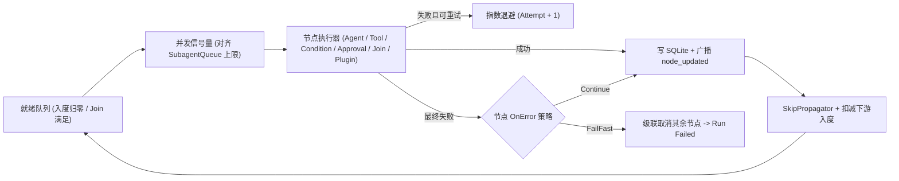

# 12 · Workflow(工作流编排与可视化)

状态:**已按 Claude Code 对话内动态工作流模式落地并验证**(无独立侧边栏低代码编辑页;主 Agent 通过内置 `RunWorkflow` 工具传入 `title` + `steps(depends_on)` 创建动态 DAG,运行时并行/串行调度独立子会话 Agent、工具与 `InteractionGate` 审批,并在对话面板输入框上方可折叠常驻画布 + 对话流内联 `WorkflowRunCard` 中经 `NcwWorkflowCanvas`(`TKCode.Arc.Workflow 1.3.0`)实时渲染)。

本文定义 NextCoWork 3.0 的 **Workflow** 子系统:在既有 `RunRegistry`、子代理、权限与交互闸门之上,提供**确定性与智能体混合(Deterministic–Agentic Hybrid)**的有向无环图(DAG)编排能力,并在界面中使用 `TKCode.Arc.Workflow` 展示实时运行图与可视化编排器。

---

## 1. 定位、使用模式与边界

### 1.1 与现有编排原语的关系

| 能力 | 形态 | 适用场景 | 与 Workflow 的关系 |
|---|---|---|---|
| **Plan(计划模式)** | 单会话 Markdown + 写入围栏 | 一次性改动前对齐方案 | 正交;复杂计划可导出或触发 Workflow |
| **Todo(待办)** | 转录派生的线性清单 | 单 Run 线性进度追踪 | Workflow 运行期间,父会话的 `TodoReconciler` 自动让路(`YieldTo`) |
| **Goal(目标)** | 旁路评估器驱动的开环循环 | 开放式、路径不可预知的长程目标 | Workflow 面向**结构化、可观测、可审批、可复用**的 DAG |
| **Subagent(子代理)** | `Task` 工具动态派生的子 Run | 单次临时委托 | Workflow 的 `Agent` 节点复用同一套子 Run、独立子会话与并发队列机制 |
| **Scheduled(定时任务)** | 时间触发的单次 `RunOrigin.Scheduled` | 周期性自动执行 | 定时任务可直接绑定 `workflowId` 作为触发目标(Phase 2) |

### 1.2 混合模式(两种形态,同一引擎)

1. **可复用工作流模板(Saved Workflow)**:
   - 存为 JSON 文件:项目级 `<项目根>/.next-cowork/workflows/*.json`(随 Git 协作,经 `IExecutionEnvironment` 读写)与全局级 `<数据根>/workflows/*.json`(本机环境)。
   - 支持在主工作区画布中拖拽编排、手动运行、被定时任务触发、或由主 Agent 通过工具调用。
2. **会话内即时工作流(Ephemeral / Ad-hoc Workflow)**:
   - 主 Agent 面对多阶段复杂任务(如「并行调研 3 个模块 → 汇聚对比 → 人工审批 → 修改代码 → 跑测试」)时,调用内置工具 `RunWorkflow` 提交一份内联 DAG 定义。
   - 不写入磁盘模板目录,直接把冻结的定义快照写入运行记录(`workflow_runs`),并在对话流内联卡片与工作区画布中实时渲染。

### 1.3 非目标(明确不做)

- **不做面向用户的命令行入口**(AGENTS.md §1):不提供 `ncw workflow run` 等 CLI。
- **不做通用低代码 / 无限循环图引擎**:默认强制 DAG(`AllowCycles = false`),循环迭代需求由单节点内的 Agent 多回合循环或 Goal 承担,避免失控死循环与费用爆炸。
- **不在移动端做拖拽连线编辑器**:手机端(`< 720px`)专注「只读缩略图 + 垂直步骤时间线 + 长按审批」(§9.4)。
- **不引入 Node / 第三方表达式脚本引擎**:变量插值与条件求值纯托管实现(NativeAOT 零反射);自定义 JS 节点**只**经 `Ncw.Agent.Plugins` 的 Jaunt 沙箱(`JsProfile.Hardened` + `JsLimits`)。

---

## 2. 项目结构与依赖规则

```
src/
├─ Ncw.Core/Domain/Workflows.cs             # 定义模型、状态机、DAG 校验、单调合并纯函数(Agent 与客户端共用)
├─ Ncw.Protocol/Methods/WorkflowMethods.cs  # 方法表、DTO(PolyType 源生成)、workflow/<id> 主题
├─ Ncw.Agent.Storage/Schema/V3/             # 增量迁移:workflow_runs、workflow_node_runs
├─ Ncw.Agent.Workflows/                     # ★ 新增:加载器、DAG 调度引擎、节点执行器、内置工具
├─ Ncw.Agent.Host/Workflows/                # RPC 路由、订阅推送、与 RunRegistry / InteractionGate 接线
├─ Ncw.Client/
│  ├─ Stores/WorkflowState.cs               # WorkflowMirror + WorkflowReducer(key 带 deviceId)
│  ├─ Actions/WorkflowActions.cs            # 所有用户意图的唯一入口
│  └─ ViewModels/Workflow*.cs               # 画布投影、节点检查器、内联卡片 ViewModel
└─ Ncw.UI/
   ├─ Controls/NcwWorkflowCanvas.cs         # ★ 对 TKCode.Arc.Workflow 的唯一薄封装
   ├─ Views/Desktop/Workflow/               # WorkflowTabView、WorkflowRunCard、WorkflowNodeInspector
   └─ Views/Mobile/WorkflowRunPage.axaml    # 移动端只读缩略图 + 步骤时间线
```

依赖规则(由 `ArchitectureTests` 守):
- `Ncw.Agent.Workflows` 只依赖 `Ncw.Core`、`Ncw.Agent.Runs`、`Ncw.Agent.Extensions`、`Ncw.Agent.Environments`、`Ncw.Agent.Storage`、`Ncw.Agent.Tools`、`Ncw.Agent.Subagents`(复用子代理定义与模型选择)、`Ncw.Agent.Plugins`(仅抽象接口)。**不引用** `Ncw.Protocol`、`Ncw.Agent.Host`、Avalonia 或任何客户端项目。
- 文件与进程访问一律经 `IExecutionEnvironment`,不得直接碰本机 `System.IO` / `Process`(全局 `<数据根>/workflows` 经本机环境实例访问)。
- 全部项目零反射序列化,NativeAOT 发布零裁剪警告。
- **包版本锁定**:`Directory.Packages.props` 新增 `<PackageVersion Include="TKCode.Arc.Workflow" Version="1.3.2-preview.4" />`,与 `TKCode.Arc` 全家版本完全一致(AGENTS.md §2)。

---

## 3. 定义格式(JSON Schema 与落盘规范)

### 3.1 文件位置与优先级

| 作用域 | 目录 | 读取通道 | 同名冲突规则 |
|---|---|---|---|
| `project` | `<项目根>/.next-cowork/workflows/<id>.json` | 项目的 `IExecutionEnvironment`(路径守卫,拒绝软链逃逸) | 同 `id` 时项目级覆盖全局级 |
| `global` | `<数据根>/workflows/<id>.json` | 设备本机环境 | 被同名项目级覆盖 |
| `ephemeral` | 不落模板文件(冻结在 `workflow_runs.definition_json`) | — | 仅属于单次运行 |

- `<id>` 规范:`^[a-z0-9][a-z0-9_-]{0,63}$`,单个文件上限 `512 KiB`。
- 加载器(`WorkflowLoader`)**永不抛异常**(执行环境连接断开除外:原样抛出,不能判成「没有工作流」);坏文件跳过并产出结构化 `WorkflowDiagnostic(Path, Key, Message, Params)`(稳定 `workflows.diag.*` key + 英文诊断,控制端翻译)。

### 3.2 JSON 结构示例(`schemaVersion: 1`)

```json
{
  "schemaVersion": 1,
  "id": "pr-review-pipeline",
  "name": "PR 审查与修复流水线",
  "description": "并行审查代码与安全问题，人工确认后自动修复并跑测试",
  "layoutDirection": "topToBottom",
  "inputs": [
    { "name": "branch", "type": "string", "required": true, "default": "HEAD" }
  ],
  "nodes": [
    {
      "id": "start",
      "kind": "trigger",
      "title": "触发入口",
      "description": "接收目标分支参数",
      "position": { "x": 240, "y": 40 }
    },
    {
      "id": "diff",
      "kind": "tool",
      "title": "获取变更 Diff",
      "position": { "x": 240, "y": 150 },
      "config": {
        "toolName": "Bash",
        "args": { "command": "git diff origin/main...{{inputs.branch}}" },
        "timeoutSec": 60
      }
    },
    {
      "id": "review_logic",
      "kind": "agent",
      "title": "逻辑与架构审查",
      "position": { "x": 40, "y": 280 },
      "config": {
        "prompt": "审查以下 diff 的正确性与边界问题：\n{{nodes.diff.output}}",
        "subagent": "code-reviewer",
        "permissionMode": "ask",
        "maxTurns": 10
      }
    },
    {
      "id": "review_sec",
      "kind": "agent",
      "title": "安全审查",
      "position": { "x": 440, "y": 280 },
      "config": {
        "prompt": "检查以下 diff 的安全风险：\n{{nodes.diff.output}}",
        "permissionMode": "ask",
        "maxTurns": 8
      }
    },
    {
      "id": "merge_reviews",
      "kind": "join",
      "title": "汇总审查意见",
      "position": { "x": 240, "y": 410 },
      "config": { "strategy": "all" }
    },
    {
      "id": "approve_fix",
      "kind": "approval",
      "title": "确认是否自动修复",
      "position": { "x": 240, "y": 530 },
      "outputs": [
        { "id": "approved", "label": "允许修复" },
        { "id": "rejected", "label": "仅保留报告" }
      ],
      "config": {
        "summaryTemplate": "逻辑审查：{{nodes.review_logic.summary}}\n安全审查：{{nodes.review_sec.summary}}"
      }
    },
    {
      "id": "apply_fix",
      "kind": "agent",
      "title": "应用修复并验证",
      "position": { "x": 80, "y": 670 },
      "config": {
        "prompt": "根据汇总意见修复问题并运行测试：\n{{nodes.merge_reviews.output}}",
        "permissionMode": "auto"
      }
    },
    {
      "id": "done",
      "kind": "output",
      "title": "输出最终报告",
      "position": { "x": 240, "y": 800 },
      "config": {
        "outputTemplate": "{{nodes.apply_fix.output ?? nodes.merge_reviews.output}}"
      }
    }
  ],
  "edges": [
    { "id": "e1", "source": "start", "target": "diff" },
    { "id": "e2", "source": "diff", "target": "review_logic" },
    { "id": "e3", "source": "diff", "target": "review_sec" },
    { "id": "e4", "source": "review_logic", "target": "merge_reviews" },
    { "id": "e5", "source": "review_sec", "target": "merge_reviews" },
    { "id": "e6", "source": "merge_reviews", "target": "approve_fix" },
    { "id": "e7", "source": "approve_fix", "sourcePort": "approved", "target": "apply_fix" },
    { "id": "e8", "source": "approve_fix", "sourcePort": "rejected", "target": "done" },
    { "id": "e9", "source": "apply_fix", "target": "done" }
  ]
}
```

- `position` 可省略(null):由 `WorkflowCanvas` 自动排版(`PlaceUnplaced` / `ArrangeNodes`),适合 Agent 生成的即时工作流;用户在画布拖动保存后写回具体坐标。
- 所有节点对象保留未识别扩展字段(向前兼容),反序列化使用 `System.Text.Json` 源生成 `WorkflowJsonContext`。

---

## 4. 领域模型与纯函数(`Ncw.Core/Domain/Workflows.cs`)

### 4.1 节点类型(8 类)

| `WorkflowNodeKind` | 画布卡片外观 | 端口约定 | 语义 |
|---|---|---|---|
| `Trigger` | `Compact`(200×84) | `HasDefaultInput = false`,1 隐式输出 | 入口节点,声明并校验 `inputs` |
| `Agent` | `Standard`(300×60) | 默认入/出 | 独立子会话执行 LLM 回合循环(复用 Subagent 机制) |
| `Tool` | `Standard`(300×60) | 默认入/出 | 经 `IExecutionEnvironment` 执行确定性工具/Shell,不耗 LLM Token |
| `Condition` | `Compact`(200×84) | 默认入,多命名输出(如 `true`/`false` 或多路 `case`) | 条件分支:支持确定性表达式或无工具/禁思考旁路 LLM 分类器 |
| `Approval` | `Compact`(200×84) | 默认入,双命名输出(`approved` / `rejected`) | 经 `InteractionGate` 挂起等待人工确认或输入,支持桌面与手机长按允许 |
| `Join` | `Compact`(200×84) | 多入,1 隐式输出 | 扇入汇聚:`All`(全成功) / `Any`(首个成功即放行) / `SettleAll`(全部终态后继续) |
| `Plugin` | `Standard`(300×60) | 按插件声明端口 | 经 `Ncw.Agent.Plugins` 的 Jaunt 沙箱执行插件节点(受 `JsLimits` + `JsProfile.Hardened` 约束) |
| `Output` | `Compact`(200×84) | 默认入,无输出 | 终态汇总,产出工作流最终 `summary` 与 `outputJson` |

### 4.2 状态机与单调合并(规则 6 & 7)

- **Workflow 运行状态(`WorkflowRunStatus`)**:
  `Queued` → `Running` ⇄ `WaitingApproval` → 终态(`Completed` | `Failed` | `Cancelled`);设备断开时在客户端派生为 `Unknown`(显示「连接中…」,不判结束、不继续计时)。
- **节点运行状态(`WorkflowNodeRunStatus`)**:
  `Pending` → `Running` ⇄ `WaitingApproval` → 终态(`Done` | `Failed` | `Skipped` | `Cancelled`)。
- **边运行状态(`WorkflowEdgeRunStatus`)**:
  `Idle` | `Active` | `Skipped`。
- **单调合并纯函数(`WorkflowView.MergeRun` / `WorkflowView.MergeNode`)**:
  - 同一 `Attempt` 内严格按秩单调:`Unknown(0) < Pending/Queued(1) < Running/WaitingApproval(2) < Terminal(3)`,终态压过运行中,首个终态胜出,重放旧事件绝不能复活已结束的节点或工作流。
  - 单节点重试时 `Attempt` 严格递增:`Attempt` 更大者覆盖更小者。
  - Agent 落库与 Client `WorkflowReducer` 调用**同一个**纯函数。

### 4.3 静态校验纯函数(`WorkflowValidator.Validate`)

前后端共用同一份校验函数,返回结构化诊断列表(`WorkflowValidationError(Code, NodeId?, EdgeId?, Params)`):
1. **DAG 判环**:Kahn 拓扑排序,存在环直接拒绝(`workflows.invalid.cycle`)。
2. **入口唯一性**:必须有且仅有 1 个 `Trigger` 节点(或 0 个时允许入度为 0 的节点作为隐式入口,推荐显式 `Trigger`),且 `Trigger` 不能有入边。
3. **边与端口合法性**:`source` / `target` 必须存在;命名端口必须存在于对应节点;若两端均声明 `DataType` 则必须一致;遵守端口 `MaxConnections`。
4. **规模与安全护栏**:单图节点数 ≤ 64,边数 ≤ 256,模板字符串长度 ≤ 64 KiB。

---

## 5. Agent 侧执行引擎(`src/Ncw.Agent.Workflows`)

### 5.1 拓扑调度与并行执行(`WorkflowEngine`)



1. **就绪判定**:
   - 普通节点:所有入边均已定态(至少一条 `Active`,其余可为 `Skipped`)时入就绪队列;若**所有入边均为 `Skipped`**,不执行,直接标为 `Skipped` 并继续向下传播。
   - `Join` 节点:
     - `All`:所有非 `Skipped` 入边均到达 `Done`(且至少一条)才就绪;任一活跃上游失败则 `Join` 失败。
     - `Any`:第一条入边到达 `Done` 即就绪(其余仍在跑的上游分支按配置选择继续或取消)。
     - `SettleAll`:所有入边进入终态(无论 `Done`/`Failed`/`Skipped`)即就绪,汇总各分支状态供下游判断。
2. **并发控制**:
   - 节点并行度受配置上限约束(默认每工作流最多 4 路并行,复用设置中的子代理并发策略);`Agent` 节点内部启动子 Run 时同时受全局 `SubagentQueue` 限额约束,不会打爆模型配额。

### 5.2 Agent 节点的独立子会话机制

每个 `Agent` 节点执行时:
1. 通过 `RunRegistry.Launch` 创建独立子 Run:
   - `RunId`:`<workflowRunId>:node:<nodeId>:a<attempt>`
   - `Origin`:`RunOrigin.WorkflowNode`(与 `RunOrigin.Subagent` 同属非顶层派生 Run)
   - `ParentRunId`:`<workflowRunId>`
   - `ParentSessionId`:若工作流由某会话发起,则指向该会话;否则指向工作流专属隐藏根会话(不进侧边栏会话列表,删父会话时连带清理)。
   - `ChildSessionId`:新建独立子会话,落库完整消息与工具调用历史,供右侧检查器按需订阅查看只读转录。
2. **上下文与数据流**:
   - 节点启动时由 `TemplateResolver` 将 `prompt` 中的 `{{inputs.*}}` 与 `{{nodes.<id>.output}}` / `{{nodes.<id>.json.<path>}}` 渲染为首条输入消息(纯托管 `JsonDocument` 寻址,无反射)。
   - 节点完成后,取子会话最后一条助手消息作为 `outputText`;若节点声明了 `outputSchema`(可选 JSON Schema),则在末尾提取结构化 `outputJson`,供下游 `Condition` / `Tool` / `Agent` 精确引用。
   - 上游输出插值到下游 Prompt 时标记为不可信数据(削控制字符、单字段长度护栏 ≤ 128 KiB 超限截断并附提示),防止意外撑爆上下文。
3. **权限与交互**:
   - **权限只收窄**:节点生效权限 = `min(工作流发起时权限档位, 节点声明 permissionMode)`。
   - **审批规则**:
     - `Agent` / `Tool` 节点的工具审批与 `Approval` 节点的人工确认**统一走 `InteractionGate`**(挂在工作流总控 Run 下,纳入 `activeRuns` 的 `pendingInteractions` 计数)。
     - 所有涉及执行的审批与工具卡片**必须带上执行环境标识(设备 + 环境)**(AGENTS.md §5)。
     - 移动端收件箱与「长按允许」无需额外协议即可直接审批工作流节点。
4. **嵌套护栏**:
   - Workflow 内部 `Agent` 节点若再调用 `RunWorkflow` 工具,深度 `+1`,沿用 `MaxDepth = 2`(第 3 层直接拒绝并说明原因,不建 Run / 会话)。

### 5.3 中止、故障恢复与断点续跑

- **级联中止**:`workflows.cancel` 触发总控 `CancellationToken` → 取消所有运行中 `Agent` 子 Run、杀掉前台 `Tool` 进程、结清挂起 `InteractionGate` 交互、剩余 `Pending` 节点标为 `Cancelled`。看门狗语义同 `RunRegistry`(5 秒强收 + `Abandoned` 后停写库)。
- **断点续跑(`workflows.resume`)**:
  - 仅允许对终态为 `Failed` / `Cancelled` 的运行发起;
  - 从 SQLite 读取冻结的 `definition_json` 与各节点最新 `Attempt` 的终态:所有已 `Done` 节点直接保留输出不重跑,失败/取消/未运行节点递增 `Attempt` 重新入调度队列。
- **单节点重试(`workflows.retryNode`)**:
  - 对指定失败节点递增 `Attempt` 重跑,并将其下游受影响节点重置为新 `Attempt` 的 `Pending`。
- **与现有扩展的协同**:
  - 父会话有运行中的关联 Workflow 时,`TodoReconciler` 的 `YieldTo` 返回 true(不催待办);
  - 主 Agent 内置工具 `RunWorkflowTool` 支持 `run_in_background: true`(立即返回 `workflowRunId`,完成后经 `RunRegistry.DeliverInternal` 向父会话汇报结果摘要)。

---

## 6. 存储层增量迁移(`Ncw.Agent.Storage/Schema/V3/`)

沿用 SQLite 增量迁移(不改 2.x 任何既有表),新增两张表:

```sql
CREATE TABLE IF NOT EXISTS workflow_runs (
    id                TEXT PRIMARY KEY,
    workspace_id      TEXT NOT NULL,
    session_id        TEXT,                  -- 触发该工作流的父会话(手动/定时可空)
    workflow_id       TEXT,                  -- 模板 id(即时工作流为 NULL)
    title             TEXT NOT NULL,
    definition_json   TEXT NOT NULL,         -- 冻结的运行时 DAG 快照
    inputs_json       TEXT NOT NULL,
    status            TEXT NOT NULL,         -- queued/running/waiting_approval/completed/failed/cancelled
    output_text       TEXT,
    output_json       TEXT,
    error             TEXT,
    environment_id    TEXT,                  -- 执行环境标识(local 或 ssh 环境 id)
    permission_mode   TEXT NOT NULL,
    total_tokens      INTEGER NOT NULL DEFAULT 0,
    created_at        INTEGER NOT NULL,
    started_at        INTEGER,
    finished_at       INTEGER
);
CREATE INDEX IF NOT EXISTS idx_workflow_runs_workspace ON workflow_runs(workspace_id, created_at DESC);
CREATE INDEX IF NOT EXISTS idx_workflow_runs_session   ON workflow_runs(session_id, created_at DESC);

CREATE TABLE IF NOT EXISTS workflow_node_runs (
    run_id            TEXT NOT NULL,
    node_id           TEXT NOT NULL,
    attempt           INTEGER NOT NULL DEFAULT 1,
    kind              TEXT NOT NULL,
    status            TEXT NOT NULL,         -- pending/running/waiting_approval/done/failed/skipped/cancelled
    child_run_id      TEXT,                  -- Agent 节点关联的真实 RunId
    child_session_id  TEXT,                  -- Agent 节点独立子会话 id
    input_json        TEXT,
    output_text       TEXT,
    output_json       TEXT,
    error             TEXT,
    tokens            INTEGER NOT NULL DEFAULT 0,
    started_at        INTEGER,
    finished_at       INTEGER,
    PRIMARY KEY (run_id, node_id, attempt),
    FOREIGN KEY (run_id) REFERENCES workflow_runs(id) ON DELETE CASCADE
);
```

- 设备异常重启后启动对账:所有持久化仍为 `queued` / `running` / `waiting_approval` 的 `workflow_runs` 与节点一律收口为 `failed`(`workflows.error.agentRestarted`),保留已完成节点结果以便用户一键「断点续跑」。

---

## 7. 设备协议(`Ncw.Protocol/Methods/WorkflowMethods.cs`)

严格遵守 [09-protocol.md](file:///Users/token/code/NextCoWork/docs/design/09-protocol.md) 与 AGENTS.md §4:

### 7.1 能力开关与版本兼容

- 新增能力 `Capabilities.Workflows = "workflows"`。
- 老客户端连新 Agent 或新客户端连老 Agent 时,按握手能力表自动隐藏入口,不破坏 N / N-1 协议兼容。
- 全部请求/响应/事件 DTO 使用 `PolyType` 源生成,并新增黄金向量测试 `GoldenV1Workflows` 冻结线上格式。

### 7.2 方法表

所有方法承载均为 `Transports.Any`(本机 + 远程局域网 + 中继),`command` 必带幂等键,业务失败用粗粒度错误码 + `ProviderErrorDto`(`workflows.*` 稳定 key):

| 方法 | 种类 | 角色 | 说明 |
|---|---|---|---|
| `workflows.list` | query | viewer | 列出工作区可用定义(全局 + 项目)与加载诊断 `WorkflowDiagnosticDto[]` |
| `workflows.get` | query | viewer | 读取单个定义完整 JSON 结构(含坐标与版本摘要) |
| `workflows.save` | command | member | 新建或保存定义(`scope`: `project` / `global`;`expectedRevision` 防覆盖冲突,对不上返回 `conflict`) |
| `workflows.delete` | command | owner | 删除定义(幂等,不存在不报错) |
| `workflows.validate` | query | viewer | 服务端深度校验(DAG 校验 + 检查引用的子代理、工具、环境是否可用) |
| `workflows.run` | command | member | 启动工作流:客户端先生成 `WorkflowRunId`、订阅 `workflow/<id>`,再调用(传 `workflowId` 或 `inlineDefinition` + `inputs` + `sessionId?`) |
| `workflows.cancel` | command | member | 中止运行中的工作流(幂等) |
| `workflows.resume` | command | member | 断点续跑失败/中止的工作流 |
| `workflows.retryNode` | command | member | 重试单个失败节点及其下游 |
| `workflows.runs.list` | query | viewer | 游标分页查询工作区或会话的工作流历史运行 |
| `workflows.runs.get` | query | viewer | 读取单次运行的完整权威快照 `WorkflowRunSnapshotDto` |

### 7.3 订阅主题与权威广播(规则 5)

1. **`workflow/<workflowRunId>` 主题**:
   - 订阅带游标 `sinceSeq`,原子返回首帧 `WorkflowRunSnapshotDto`(与 `workflows.runs.get` 同类型) + 后续增量事件 `WorkflowRunEventDto`:
     - `node_updated`(节点状态、`attempt`、耗时、`summary`、`error`、`childRunId`、`childSessionId`、`tokens`)
     - `edge_updated`(边状态 `idle` / `active` / `skipped`)
     - `run_updated`(整体状态、耗时、总 Token、最终输出/错误)
   - 游标断层直接推送全量 `WorkflowRunSnapshotDto` 对账。
2. **`device` 主题(`activeRuns` 权威广播)**:
   - Workflow 总控 Run(`RunOrigin.Workflow`)与各 `Agent` 子 Run 均通过 `RunRegistry` 启动,因此自动出现在 `activeRuns` 权威广播中(包含待处理审批数 `pendingInteractions`),侧边栏呼吸点、项目角标、收件箱待办无需另起平行广播通道。

---

## 8. 客户端状态管理(`Ncw.Client`)

对照 [AGENTS.md §3](file:///Users/token/code/NextCoWork/AGENTS.md) 七条规则:

| 规则 | Workflow 落点 |
|---|---|
| 1. 单一真源 + 一份镜像 | 真源在 Agent;控制端只在 `ClientStores.Workflows`(`Store<WorkflowMirror>`)按 `(deviceId, workspaceId)` 与 `(deviceId, workflowRunId)` 保存唯一镜像 |
| 2. 视图不持有业务状态 | `WorkflowTabView` / `WorkflowRunCard` 只持纯 UI 状态(当前选中节点 id、缩放偏移、未保存草稿缓存);ViewModel 不直接订阅协议事件 |
| 3. 派生只有一个函数 | 节点状态映射、进度文本(`3/6`)、耗时、能否取消/续跑/重试全部是 `Ncw.Core.Domain.WorkflowView` 下的纯函数 |
| 4. 动作只有一份 | 侧边栏、工具栏、内联卡片、检查器的所有操作全部收敛到 `WorkflowActions`(例如 `StartRunAsync` / `CancelRunAsync` / `SaveDefinitionAsync`) |
| 5. 全量权威广播兜底 | `workflow/<id>` 首帧与断层重发全量 `WorkflowRunSnapshotDto`;全局运行态由 `activeRuns` 定期全量对账 |
| 6. 状态单调 | `WorkflowReducer` 调 `WorkflowView.MergeRun` / `MergeNode`,终态压过运行中,高 `Attempt` 压过低 `Attempt` |
| 7. 派生视图跟随真源 | 内联卡片、标签页、检查器、移动端共享同一份 `WorkflowRunMirror`;设备断开时标 `Unknown`,停止计时,重连对账后收口 |

---

## 9. 界面展示与 `TKCode.Arc.Workflow` 集成(`Ncw.UI`)

### 9.1 `TKCode.Arc.Workflow` 映射与薄封装(`NcwWorkflowCanvas`)

在 `src/Ncw.UI/Controls/NcwWorkflowCanvas.cs` 中建立对 `TKCode.Arc.Workflow` 的唯一封装层(业务视图绝不直接引用 `arc:WorkflowCanvas`),并在 [NcwAppSetup.cs](file:///Users/token/code/NextCoWork/src/Ncw.UI/NcwAppSetup.cs) 中注册 `.UseArcWorkflow()`。

- **模型投影(Store → `WorkflowGraph`)**:
  - `WorkflowGraph` 是画布渲染对象,由 `NcwWorkflowCanvas` 根据不可变的 `WorkflowDefinition` + `WorkflowRunMirror` 做增量 Diff 更新(复用现有 `WorkflowNode` 实例以保留 `WorkflowCanvas.QueueRunVisuals` 的连线流动动画,避免整图重建闪烁)。
- **状态精确映射**:

| `WorkflowNodeRunStatus` | `TKCode.Arc.WorkflowNodeState` | 附加视觉(经 `WorkflowNodeTemplate`) |
|---|---|---|
| (编辑态无运行) | `Idle` | 显示节点类型图标与描述 |
| `Pending` | `Pending` | 空心等待环 |
| `Running` | `Running` | 旋转强调色环 + 若为 Agent 节点显示当前工具摘要 |
| `WaitingApproval` | `Running` | 叠加 `WarningSubtle`/`Warning` 提醒色「待审批」胶囊 |
| `Done` | `Done` | 耗时(`Duration`) + 完成对勾 + `Result` 替换描述行 |
| `Failed` | `Failed` | 告警标记 + `Error` 摘要 |
| `Skipped` | `Skipped` | 卡片淡显,关联边自动虚线(`WorkflowEdgeState.Skipped`) |
| `Cancelled` | `Skipped` | 卡片淡显 + 取消角标 |

- **画布能力启用**:
  - `QueueRunVisuals = true`:上游完成且数据沿边绘制到下游卡片后,下游才点亮为 `Running`,直观呈现 DAG 数据流;
  - `WorkflowMinimap` + `WorkflowZoomControls` 绑定 `Target = Canvas`,通过 `ShowChrome` 属性控制(全屏标签页开启,内联卡片关闭);
  - `VirtualizeAbove` 自动生效,大工作流无性能退化;
  - 所有文案走 `NcwTextKind` + `en-US.xlf` / `zh-CN.xlf`,所有图标在 [Ncw.UI.csproj](file:///Users/token/code/NextCoWork/src/Ncw.UI/Ncw.UI.csproj) `<LucideIcon>` 静态声明,零硬编码颜色。

### 9.2 桌面端三个协同落点

不改动现有「左侧边栏 + 主工作区 + 右侧检查器」三栏骨架([03-ui-layout.md](file:///Users/token/code/NextCoWork/docs/design/03-ui-layout.md)):

```
┌──────────────────────┬────────────────────────────────────────────────────┬─────────────────────────┐
│ 全局入口              │ [✱ 重构登录 ×] [⑂ PR 审查流水线 ×]         +  ⋯  ◨ │ 检查器 · 节点详情        │
│ ✎ 新会话        ⌘N   ├────────────────────────────────────────────────────┤ ─────────────────────── │
│ ⌕ 搜索          ⌘K   │ [编辑|运行] [竖排|横排] [自动排版] [撤销][重做] [▶ 运行]│ 逻辑与架构审查 (Agent)   │
│ ▤ 收件箱         ③   ├────────────────────────────────────────────────────┤ 状态: 运行中 · 12.4s     │
│ ◷ 定时任务            │               ┌───────────────────┐                │ 环境: 本机 · ask         │
│ ⑂ 工作流              │               │  ● 触发入口        │                │ ─────────────────────── │
│ ──────────────────── │               └─────────┬─────────┘                │ [配置] [输出] [子转录]   │
│ 项目树                │                         ▼                          │                         │
│ ▾ NextCoWork         │               ┌───────────────────┐                │ (复用 SubagentsPane 的  │
│   ● 重构登录          │               │  ✓ 获取变更 Diff   │                │  只读转录视图,实时看    │
│                      │               └────┬─────────┬────┘                │  该节点的思考与工具调用) │
│                      │                    ▼         ▼                     │                         │
│                      │           ┌────────────┐ ┌────────────┐            │                         │
│                      │           │ ◌ 逻辑审查  │ │ ✓ 安全审查  │            │                         │
│                      │           └────────────┘ └────────────┘            │                         │
│                      │                                   [小地图] [− 100% +]│                         │
└──────────────────────┴────────────────────────────────────────────────────┴─────────────────────────┘
```

#### 落点 1 · 主工作区标签页(`WorkflowTabView`)
- **入口**:左侧边栏全局入口「定时任务」下方新增「工作流」(点开列表页,类似 `SchedulesPage`);打开某个模板或运行记录时,在 [WorkspaceArea.axaml](file:///Users/token/code/NextCoWork/src/Ncw.UI/Views/Desktop/WorkspaceArea.axaml) 新开一个 `Workflow` 标签页。
- **编辑交互**:
  - 拖线到画布空白处(`ConnectionDroppedOnCanvas`)→ 就地弹出节点类型菜单,选中即建节点并连线;
  - 节点移动/删除/连线/粘贴触发 `GraphEdited` → 更新纯 UI 草稿(标签页显示未保存圆点,同文件标签规则),`⌘S` 或点「保存」经 `WorkflowActions.SaveDefinitionAsync` 写回设备;
  - 撤销/重做直接绑定 `WorkflowCanvas.UndoCommand` / `RedoCommand`(`WorkflowGraph.History`);
  - 实时校验错误汇总为顶部轻提示条,点错误自动 `ScrollIntoView(node)` 定位节点。

#### 落点 2 · 对话流内联卡片(`WorkflowRunCard`)
- 主 Agent 调用 `RunWorkflow` 时,对话转录中插入 `WorkflowRunCard`(与 `SubagentCard` / `WidgetCard` 同级):
  - **头部**:工作流标题、状态与进度(`3 / 6 步`)、耗时、执行环境徽标、「停止」按钮、「在标签页打开」按钮;
  - **画布区**:内嵌只读 `NcwWorkflowCanvas`(`IsEditable = false`, `IsPanZoomEnabled = false`, `AutoFit = ShrinkToFit`, `ShowChrome = false`, 高度 `220–280px`);
  - **底部操作条**:当有 `Approval` 节点挂起时,直接复用 `InteractionCard` 展示审批操作;点击任意节点可在右侧检查器打开该节点详情。

#### 落点 3 · 右侧检查器联动(`WorkflowNodeInspector`)
- 遵循 `InspectorTabs.Compose` 的按需页签机制(类似 `Subagents` 页签):当活动标签为 Workflow 或选中了内联卡片的节点时自动出现「节点」页签:
  - **编辑态**:节点标题、类型、Prompt/Shell/条件表达式、子代理模板、模型、权限档位(只允许收窄)、超时与重试策略、命名端口增删;
  - **运行态**:节点输入/输出(`NcwCodeBlock` 只读高亮)、耗时与 Token、失败原因与「从此节点重试」按钮;对于 `Agent` 节点,**直接复用 `SubagentsPane` 的只读子会话转录组件**(点开才按 `childSessionId` 订阅)。

### 9.3 移动端(`< 720px`)与窄屏适配

- 桌面窄窗口(`720–1440px`):检查器自动切为右侧抽屉(复用现有 `ShellViewModel.IsInspectorDrawerOpen`),画布启用 `NarrowBelowWidth = 520` 自动收窄卡片尺寸。
- 手机壳(`MobileShell`, `< 720px`):
  - 不开放编辑模式;
  - `WorkflowRunPage` 顶部展示可手势缩放的只读 `NcwWorkflowCanvas` 缩略图,下方展示按拓扑序排列的**垂直步骤时间线列表**;
  - 点击步骤进入详情页查看输出/子转录;`Approval` 节点直接复用 `NcwHoldButton`「长按允许」审批(同 [03 §7](03-ui-layout.md#审批的长按允许02-b2))。

---

## 10. 不变量清单与分阶段实施路线

### 10.1 核心不变量(实现时须有对应单测)

| # | 不变量 | 测试落点 |
|---|---|---|
| WF1 | **DAG 无环**:任何带环定义在编辑校验与服务端启动前均被拒绝 | `Ncw.Core.Tests.WorkflowValidatorTests` |
| WF2 | **状态单调**:终态压过运行中,重放旧事件不复活,更高 `Attempt` 覆盖更低 `Attempt` | `Ncw.Core.Tests.WorkflowViewTests` |
| WF3 | **断线语义**:设备断开时运行中工作流标 `Unknown`,不判结束、不继续计时,重连对账收口 | `Ncw.Client.Tests.WorkflowStoreTests` |
| WF4 | **分支跳过传播**:Condition / Approval 未命中边标 `Skipped`,下游入度全跳自动标 `Skipped`;`Join(Any)` 按策略放行 | `Ncw.Agent.Workflows.Tests.SkipPropagationTests` |
| WF5 | **权限只收窄**:节点权限永不超过工作流发起时档位;执行审批必带执行环境标识 | `Ncw.Agent.Workflows.Tests.PermissionTests` |
| WF6 | **独立子会话与清理**:每个 `Agent` 节点建独立 `childSessionId`;删父会话连带清理;不进侧边栏会话列表 | `Ncw.Agent.Workflows.Tests.AgentNodeTests` |
| WF7 | **中止级联**:取消工作流立即中止所有在跑子 Run、结清挂起交互、未开始节点标 `Cancelled`,无孤儿子 Run | `Ncw.Agent.Workflows.Tests.CancellationTests` |
| WF8 | **嵌套深度护栏**:Workflow 内部 Agent 递归调 Workflow 超过 `MaxDepth = 2` 被拒且不建 Run | `Ncw.Agent.Workflows.Tests.DepthLimitTests` |
| WF9 | **断点续跑**:`resume` 跳过已 `Done` 节点并保留其输出,仅重跑失败/未执行子图 | `Ncw.Agent.Workflows.Tests.ResumeTests` |
| WF10 | **模板与路径安全**:加载器永不抛(断连除外);拒绝软链逃逸出项目根;单文件 ≤ 512 KiB | `Ncw.Agent.Workflows.Tests.WorkflowLoaderTests` |
| WF11 | **协议兼容与黄金向量**:能力开关 `workflows` 隔离;Command 必带幂等键;线上格式黄金向量冻结 | `Ncw.Protocol.Tests.GoldenV1WorkflowsTests` |
| WF12 | **依赖与 AOT**:零跨层引用、业务视图不直接写 `arc:WorkflowCanvas`、NativeAOT 零裁剪警告 | `ArchitectureTests` + `publish-agent` |

### 10.2 分阶段实施路线

- **Phase 1(MVP:核心引擎 + 只读实时画布)**
  1. `Directory.Packages.props` 锁定 `TKCode.Arc.Workflow 1.3.2-preview.4`,`NcwAppSetup` 注册 `.UseArcWorkflow()`。
  2. `Ncw.Core/Domain/Workflows.cs` + `Ncw.Agent.Storage` V3 迁移。
  3. `Ncw.Agent.Workflows` 调度引擎 + 核心节点(`Trigger` / `Agent` / `Tool` / `Condition` / `Approval` / `Output`)+ `RunWorkflow` 工具。
  4. `Ncw.Protocol/Methods/WorkflowMethods.cs` + `Ncw.Agent.Host/Workflows` 接线。
  5. `Ncw.Client` Store/Actions + `Ncw.UI` `NcwWorkflowCanvas` + 对话内联 `WorkflowRunCard` + 主工作区只读 `WorkflowTabView` + 检查器运行态详情(含子转录)。
- **Phase 2(可视化编排器 + 模板管理 + 定时联动)**
  1. `WorkflowTabView` 开启 `IsEditable=true`:拖拽移动/连线、`ConnectionDroppedOnCanvas` 快捷加节点、撤销重做、属性检查器表单、保存至 `.next-cowork/workflows/*.json`。
  2. 侧边栏「工作流」入口与管理列表页。
  3. `ScheduledTaskService` 支持绑定 `workflowId`。
- **Phase 3(进阶编排 + 移动端)**
  1. `Join` 聚合策略、单节点重试(`workflows.retryNode`)与断点续跑(`workflows.resume`)。
  2. `Plugin` 节点接入 `Ncw.Agent.Plugins`(Jaunt 沙箱)。
  3. 移动端 `WorkflowRunPage`(只读缩略画布 + 垂直步骤时间线 + 长按审批)。
